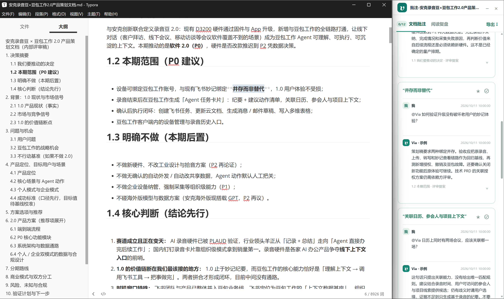
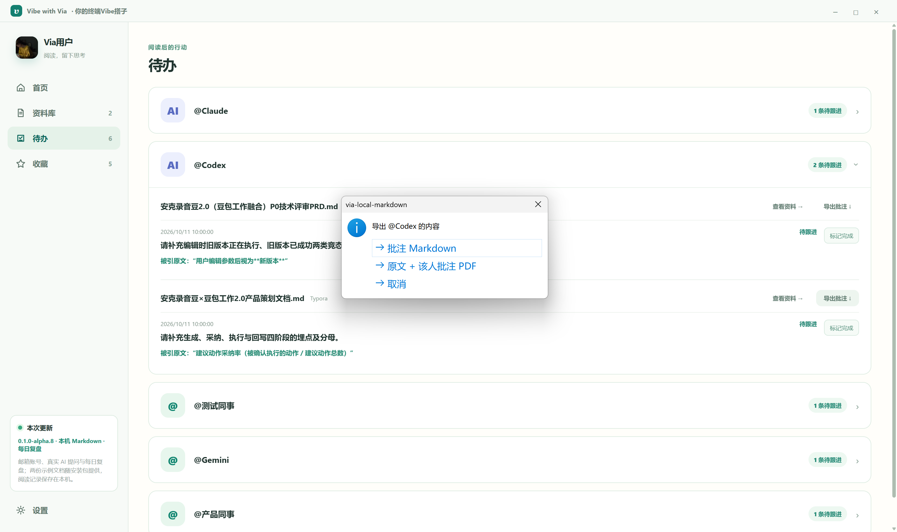
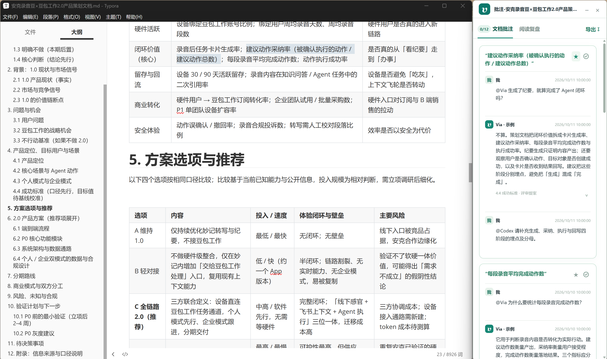
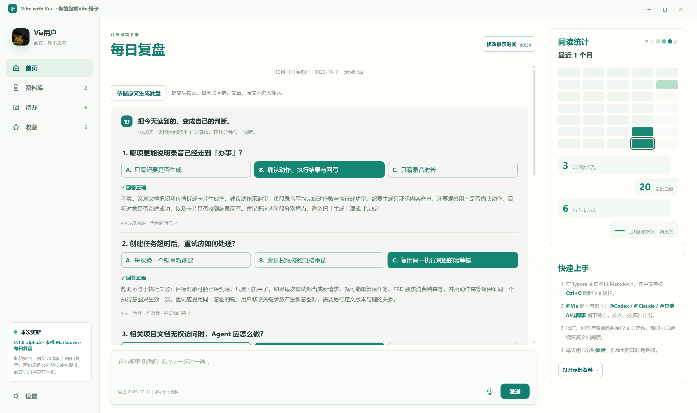
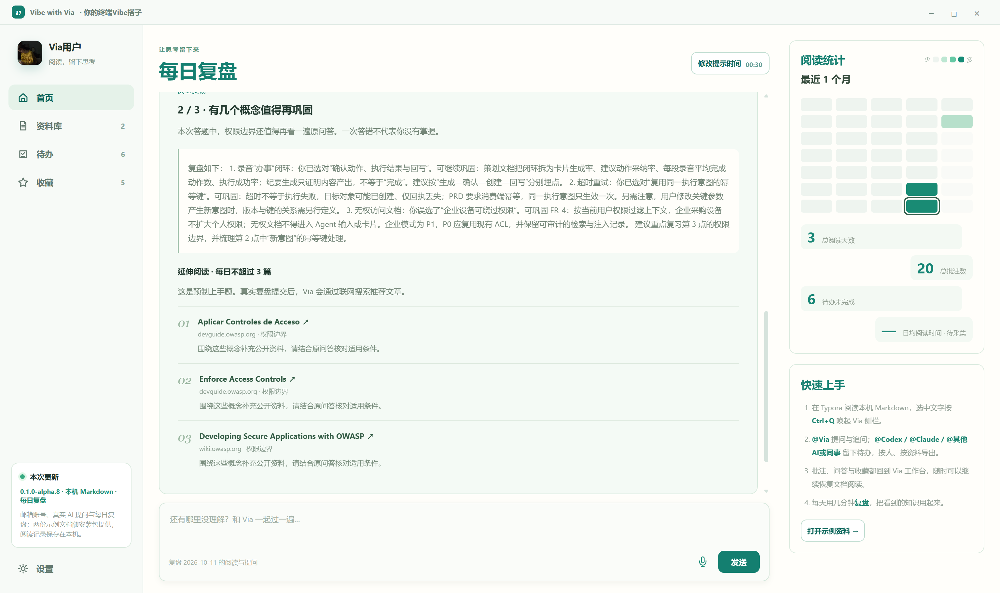
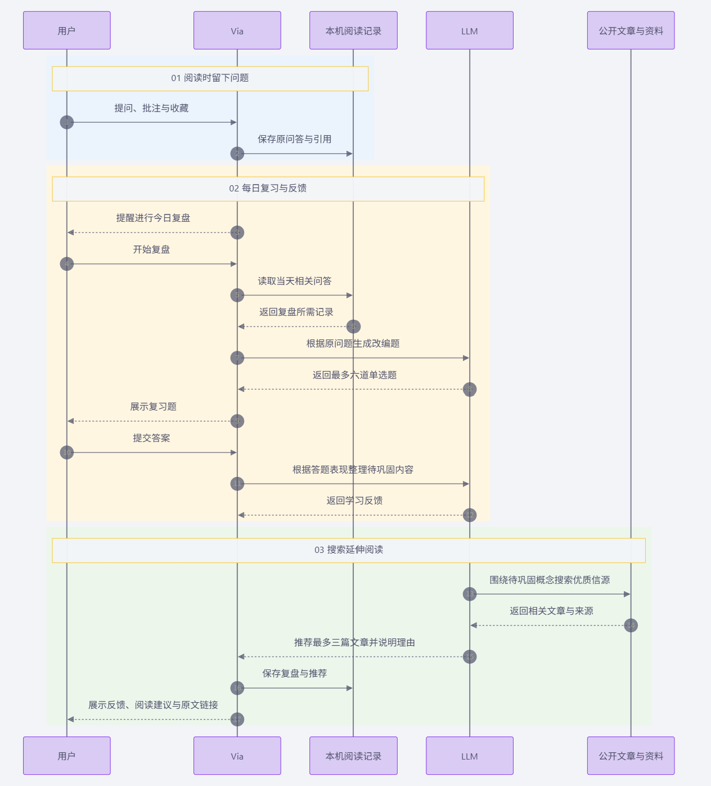

# Vibe with Via

**从「AI 替我产出」，到「我真正学会」。**

用公司 API 加终端，把 PRD 写出来越来越容易。但读到一个陌生概念、一段可疑的逻辑时，我们还是要切换窗口、复制原文、重新交代背景。文档完成了，自己却未必真正理解；昨天问过的问题，今天也可能又忘了。

Via 是为这个过程做的 **本机 Markdown 阅读伙伴**。你在 Typora 里读，Via 在原文旁陪你提问、留下判断，再用每日复盘把一次问答变成值得巩固的知识。适合用终端 AI 打磨 PRD、技术方案和产品构思的你。

## 带着原文问，也带着判断继续

选中文字，按 `Ctrl+Q` 唤起侧栏。`@Via` 带着引用、邻近原文和对话回答；你可以继续往下读，稍后回来追问、编辑或收藏。



> 以下截图来自 Windows 应用，文档与问答为内置新手示例。真实 AI 回答需要配置自己的 API 密钥。

用 `@Codex`、`@Claude`、`@其他AI` 或 `@同事` 留下修改意见，Via 按对象整理待办。导出批注 Markdown，或「原文 + 该对象批注」PDF，把下一轮协作需要的上下文一起交出去。



<details>
<summary>看看同一条批注下的追问与待办</summary>



</details>

资料、批注、问答和收藏留在本机。重新打开同一路径的文档，就能接着读，不必重新寻找散落的聊天记录。原 Markdown 保持只读，其他 `@` 对象只形成待办，由你导出交付。

## 文档写好了，你也往前走一步

每日复盘把当天提问稍作改写，生成最多 **6 道选择题**。提交后，结合原文和答题结果提示值得巩固的概念，推荐最多 **3 篇延伸阅读**。点击统计里的日期，可以回看当天的问答。



<details>
<summary>看看复盘反馈与延伸阅读</summary>



</details>

一次答错不等于你不懂。Via 希望帮你发现值得再想一遍的地方，让产品判断和技术理解随着工作一起成长。后续会结合真实使用反馈，完善复习节奏与专属知识库；当前推荐依靠联网检索，还没有精选知识库。

## 开始使用

当前为 **Windows x64 / Typora / 0.1.0-alpha.8** 试用版。首次启动会将两份示例 Markdown 和20条示例批注初始化到本机，方便快速体验。

[下载 Windows x64 安装包](https://github.com/WorldAsOyster/Via-for-Vibe-Reading/releases/download/v0.1.0-alpha.8/Via-0.1.0-alpha.8-Setup-x64.exe) · [发布说明与校验和](https://github.com/WorldAsOyster/Via-for-Vibe-Reading/releases/tag/v0.1.0-alpha.8)

从源码运行：

```powershell
cd typora-app
npm ci
npm run desktop
```

在「设置 → AI 连接」保存自己的 DeepSeek 或 OpenAI 密钥，再按「使用帮助」配置 Typora 命令和快捷键。向模型提问会发送相关引用与上下文，密钥在本机加密保存。邮箱账号接口已实现，当前使用开发环境；阅读记录不自动上传或同步。

[完整使用说明](docs/GETTING_STARTED.md) · [当前能力与验收状态](docs/STATUS.md) · [反馈与建议](https://github.com/WorldAsOyster/Via-for-Vibe-Reading/issues)

源码可用 `npm run build:win` 构建安装包。代码公开供查看，暂未授予开源许可证，© 2026 WorldAsOyster，保留全部权利。

## 它怎样工作

Electron 承载桌面主窗口和 Typora 旁的独立侧栏，通过 Windows 选区读取、快捷键和窗口排布连接阅读流程。两端共用一个本机 `DocumentStore`，避免批注各存一份；CloudBase 负责邮箱认证。

每日复盘采用固定工作流：从有引用依据的当日问答取材，LLM 出题，程序校验证据并评分，再生成巩固建议。推荐检索只发送公开概念标签，不发送私人原文、问答、文件名或路径，并核验搜索返回的来源。[详细架构与数据边界](docs/DAILY_REVIEW.md)。


