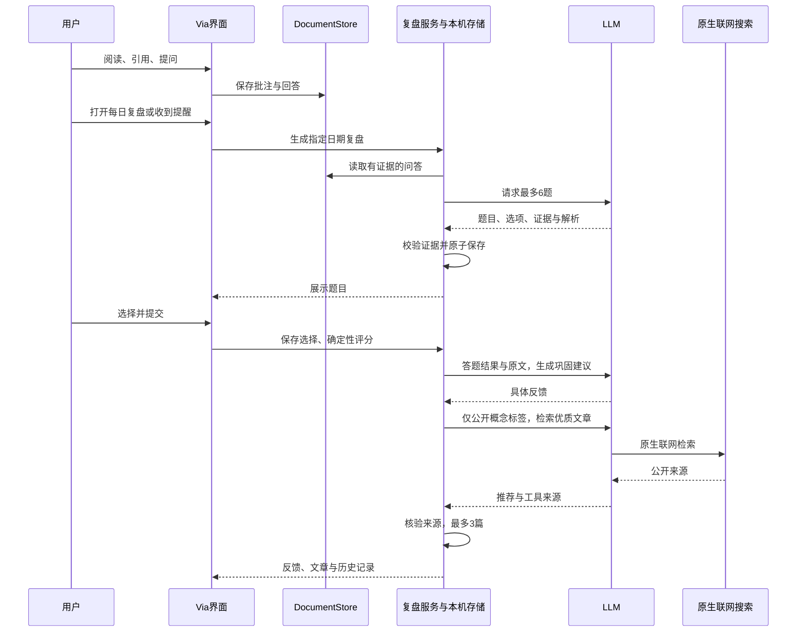

# 每日复盘当前实现

当前实现采用本机固定工作流与 LLM，目前没有精选知识库。

输入为本机DocumentStore内带引用、原文可匹配、有已完成回答的用户问题；按本地日期选择，跨文档轮询最多6条。LLM将原问题小改写成三选一，返回原文证据；应用验证引用、来源、证据摘录、选项和正确答案索引，不足时少出题。AI旧回答只供参考，不作事实依据。应用保存题目快照和模型版本，点击选择实时本机保存；提交后锁定答案，用确定规则评分。

LLM依据答题结果与原文给出≤500字的巩固建议，不能根据一次答错宣称用户不懂。联网调用只含公开概念词表标签，不含原文、问答、文件名或本机路径；原生工具返回的HTTPS官方/研究来源才可进入推荐，最多3篇，没有可信来源则显示空态。公开词表不是知识库。

同日生成去重；真实题目生成后不反复调用模型。生成期间问答变更、资料移除会阻止旧结果提交；移除资料会清理关联复盘。中断任务重启标记可重试。提醒在应用运行时触发，启动补查，不设应用关闭后的后台服务。历史天的快照供日期回看，不重新评分。

