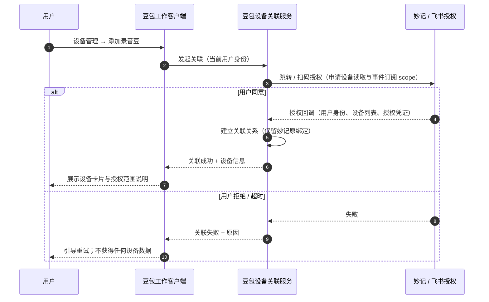
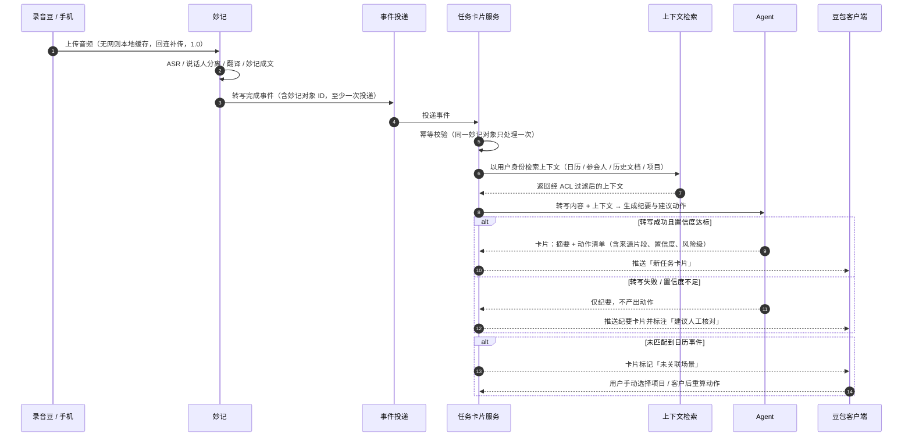
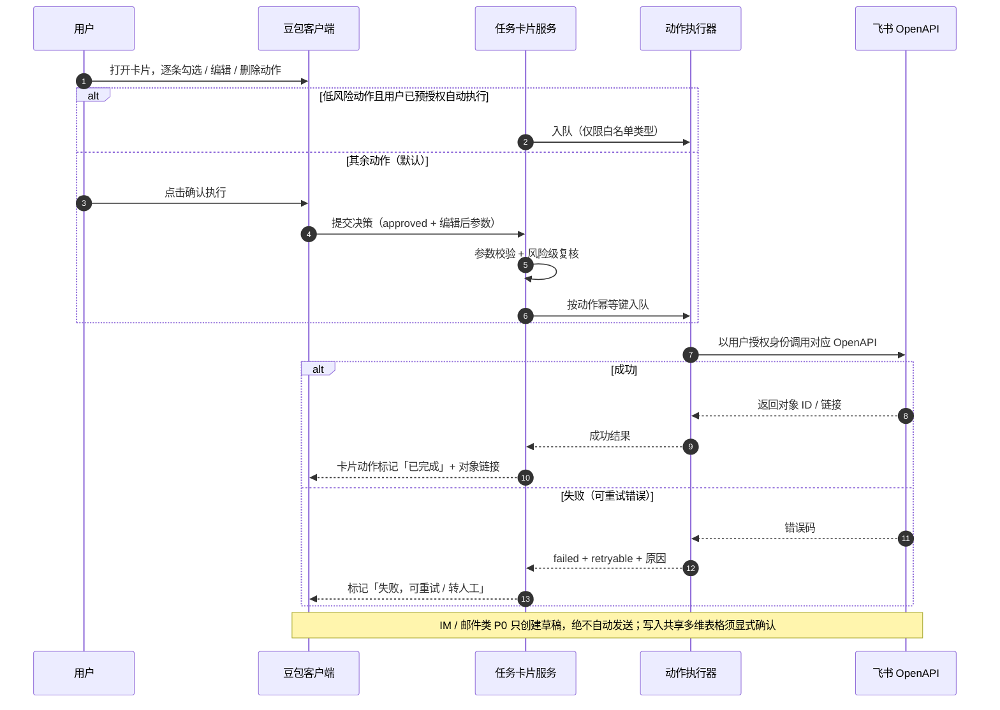
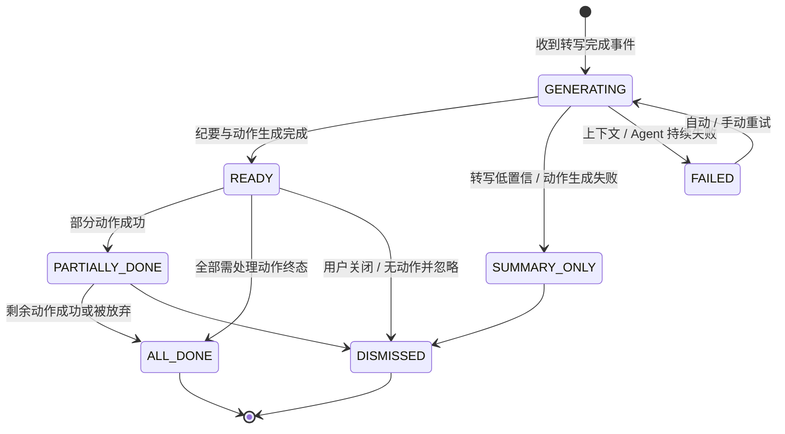
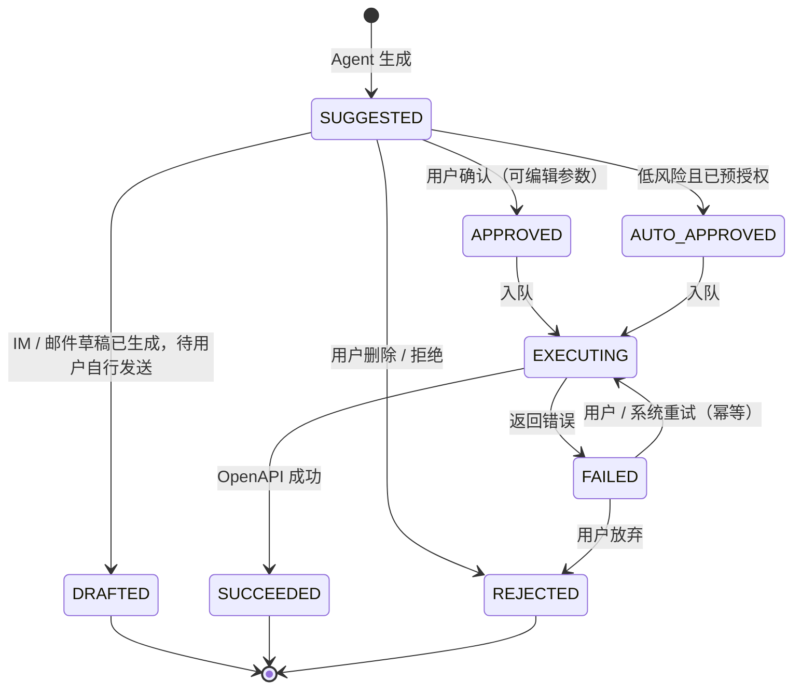

# 安克录音豆 2.0 × 豆包工作融合（P0 个人模式）技术评审 PRD


| 项    | 内容                                                                |
| ---- | ----------------------------------------------------------------- |
| 文档名称 | 安克录音豆 2.0 × 豆包工作融合 P0 技术评审 PRD                                    |
| 文档版本 | v0.9（技术评审稿）                                                       |
| 上游文档 | 《安克录音豆 × 豆包工作 2.0 产品策划文档（内部评审稿）》（以下简称「策划文档」，已定方向：选项 C，P0/P1 不改硬件） |
| 读者   | 豆包工作服务端 / 客户端、飞书妙记、安克固件与 App、安全 / 法务、QA                           |
| 本期范围 | **P0：软件 2.0 个人模式**，打通「录音 → 妙记 → Agent 任务卡片 → 确认执行」最小闭环            |
| 状态   | 待技术评审。文中所有技术方案、接口、数据模型、性能值均为**提案**，评审通过后才进入研发承诺                   |

> **标签约定（全文通用）**

【事实】= 已上线能力或公开 / 内部资料可证；【产品决定】= 策划评审已确认的范围与规则；【技术提案】= 本文为技术评审提出的建议方案，待评审确认；【待确认】= 依赖外部团队答复或 Spike 结论，确认前不构成研发承诺。


***

## 1. 本次技术评审需要做出的决定


| 编号  | 待决议问题                                                                 | 影响                          |
| --- | --------------------------------------------------------------------- | --------------------------- |
| D-1 | P0 是否采用「**音频 / 转写仍走妙记 1.0 链路，豆包侧只订阅转写完成事件并新增任务卡片服务**」的解耦架构（音频不经过豆包服务） | 决定整体架构与合规面                  |
| D-2 | 妙记是否可提供「转写完成」事件订阅（服务端到服务端），以及设备授权 scope、投递 SLA                        | P0 关键路径，不成立则退回策划文档选项 B 过渡方案 |
| D-3 | 设备 — 用户绑定关系的权威数据源（安克云 / 妙记）与豆包侧获取设备列表、状态的方式                           | 绑定与设备管理功能的前提                |
| D-4 | 动作执行的调用身份（用户 OAuth 授权 / 应用代调用）与飞书 OpenAPI scope 清单                    | 执行闭环与 ACL 合规                |
| D-5 | 统一动作协议（Action Schema）、幂等键与五类动作的参数校验规则                                 | 服务端与客户端契约                   |
| D-6 | 安克 App / 固件 P0 是否需要改造（授权跳转、补传 / 状态事件）及最低支持版本                          | 三方排期                        |
| D-7 | 初始性能与成本参数（卡片生成时延、单用户录音处理额度）是否接受为「初始值，压测 / 成本模型后校准」                    | 非功能验收基线                     |
| D-8 | 灰度路径（影子运行 → 内部 → 白名单）与各级 kill switch 的归属                              | 发布与回滚                       |


***

## 2. 背景、目标与非目标

### 2.1 背景摘要


* 【事实】录音豆 1.0：设备经安克 App / 飞书绑定后，录音上传飞书妙记，由妙记完成 ASR、说话人分离、翻译与智能纪要；体验止于纪要，无后续动作执行。

* 【事实】豆包工作已具备：继承飞书聊天 / 文档 / 日程 / 妙记等上下文（遵循飞书 ACL）、Agent 任务拆解、飞书工具调用（任务、文档、多维表格、日历、IM 等）与客户端形态。

* 【产品决定】2.0 P0 做软件融合、不动硬件；与妙记**双绑定并存、不替代 1.0**；Agent 动作默认经用户确认，不做静默外发。

* 【待确认】内部资料中**未检索到**豆包工作已有的硬件 / 外设接入协议或录音设备合作案例；现有语音转文字存在单段时长限制的反馈。设备事件通路是 P0 最大工程不确定项。

### 2.2 P0 目标（可验收）


1. 用户在豆包工作客户端完成设备关联后，每段经妙记转写完成的录音，能自动生成一张**任务卡片**（纪要摘要 + 建议动作清单），并自动关联日历事件 / 参会人 / 项目上下文。

2. 用户可在卡片上逐条确认、编辑、删除建议动作；确认后系统完成五类飞书动作并把结果（含对象链接 / 失败原因）回写卡片。

3. 1.0 的妙记链路、存量绑定与未升级用户体验**零影响**；豆包侧任一新增能力故障可一键关闭，回退到 1.0 纯妙记体验。

### 2.3 非目标（P0 不做，进入条件见策划文档路线图）


| 不做项                               | 原因 / 重新考虑条件                              |
| --------------------------------- | ---------------------------------------- |
| 新硬件、固件拾音 / 工业设计变更                 | P2 凭企业模式留存与付费数据决策                        |
| 实时音频流、实时转写浮窗、实时翻译、语音唤醒 / TTS      | 属 P1 / P2，需端上音频通道，P0 不预留重型协议但在接口版本中预留扩展位 |
| 企业 / 团队模式（设备纳管、数据归企业、审计后台、组织告知模板） | P1，需 MDM 类能力与专项合规评审                      |
| 录音写入企业知识库 / 知识问答检索                | P1                                       |
| 场景工作伙伴包（销售 / 访谈等垂直模板）             | P1；P0 仅使用通用 Agent 纪要与动作能力                |
| 自动对外发送 IM / 邮件                    | P0 只生成草稿，不自动发送；任何时候外发都需用户在飞书侧主动发出        |
| 海外版模型与跨境数据方案                      | P2                                       |
| 替代妙记做 ASR / 存储                    | P0 音频与转写完全留在妙记链路                         |


***

## 3. 范围界定：保留 / 新增 / 修改 / 暂不做


| 类别     | 内容                                                                                                          | 依据            |
| ------ | ----------------------------------------------------------------------------------------------------------- | ------------- |
| 保留（不动） | 录音豆硬件采集、按键 / 指示灯 / 震动、安克 App 与飞书的绑定入口、音频上传、妙记 ASR / 转写 / 翻译 / 纪要、妙记内的设备会话与逐字稿                               | 【事实】1.0 已上线   |
| 新增     | ① 豆包侧设备关联关系；② 妙记转写完成事件的订阅与消费；③ 任务卡片服务（生成、存储、推送）；④ 上下文关联；⑤ Agent 动作生成；⑥ 动作确认与执行回写；⑦ 客户端设备管理与录音历史入口；⑧ 配置开关与降级 | 【产品决定】+【技术提案】 |
| 修改     | 豆包工作客户端新增入口；妙记侧需**新增事件投递与授权能力**（D-2）；安克 App / 固件可能需要配合授权跳转（D-6，待确认是否必须）                                     | 【待确认】         |
| 暂不做    | 见 2.3 非目标                                                                                                   | 【产品决定】        |

**P0 最小闭环定义**：关联设备 → 录音并经妙记转写 → 收到任务卡片 → 确认至少一类动作 → 飞书侧对象被创建 / 草稿生成 → 卡片回写结果。该闭环不依赖任何 P1 能力即可独立灰度验证。


***

## 4. 关键现状基线与技术 Spike（M0 必须先闭环）

以下结论未确认前，排期与工作量均不成立；M0 阶段以 Spike 产出书面结论。


| 编号  | 待确认基线                                                                 | 确认方式                 | 责任方（建议）       | 不成立时的退路                               |
| --- | --------------------------------------------------------------------- | -------------------- | ------------- | ------------------------------------- |
| S-1 | 妙记能否在用户授权下，向豆包侧投递「某用户某设备录音转写完成」事件（含妙记对象 ID、时长、状态）                     | 妙记团队技术评估 + 联调 demo   | 妙记服务端         | 退回选项 B：妙记内「交给豆包工作处理」手动入口，豆包侧按对象 ID 拉取 |
| S-2 | 豆包侧能否凭用户授权读取妙记纪要 / 逐字稿内容及其权限边界                                        | 复用豆包工作既有妙记上下文能力做联调验证 | 豆包工作 + 妙记     | 同 S-1                                 |
| S-3 | 设备列表、绑定关系、电量 / 存储 / 固件版本 / 上传状态的权威来源与可读取接口                            | 与安克、妙记三方对齐数据源        | 安克固件 / 妙记     | P0 设备状态仅展示「在线 / 最近同步时间」，不展示电量等明细      |
| S-4 | 豆包工作以用户身份调用飞书任务 / 文档 / IM 草稿 / 邮件草稿 / 多维表格 / 日历 OpenAPI 的 scope 与授权流程 | OpenAPI 权限核查         | 豆包工作 + 飞书开放平台 | 不具备的动作类型从 P0 五类中裁剪，只保留已授权类型           |
| S-5 | 长录音（如 30 / 60 / 120 分钟）端到端链路是否存在时长瓶颈（音频不经豆包，瓶颈主要在妙记转写与 Agent 上下文长度）   | 压测 + 长文分段策略验证        | 妙记 / 豆包 Agent | 超长录音分段生成卡片，或仅出纪要不生成动作                 |
| S-6 | 典型时长录音的 ASR + Agent token 单位成本与订阅档位毛利模型                               | 成本测算（M0 产出）          | 豆包工作产品 / 工程   | 先按保守额度灰度，额度规则后定                       |
| S-7 | 安克 App / 固件是否必须改造才能支持关联授权与补传状态可见                                      | 安克评估                 | 安克            | 授权全程在豆包 / 飞书侧完成，不依赖安克 App 改造          |


***

## 5. 总体技术方案（【技术提案】，待 D-1 评审）

### 5.1 核心架构决策

**P0 采用「妙记转写事件驱动 + 豆包任务卡片服务」的解耦架构：**


1. 音频采集、上传、ASR、转写、翻译、妙记存储**全部留在 1.0 链路**，豆包服务 P0 **不接触音频文件**—— 最小化数据面、合规面与成本面，也不动硬件链路。

2. 新增的只是一条**控制 / 事件面**：妙记转写完成 → 事件投递 → 豆包任务卡片服务消费 → 上下文检索 → Agent 生成卡片 → 客户端确认 → 复用豆包既有工具调用能力执行 → 结果回写。

3. 绑定上采用「关联授权」而非新建一套设备绑定：用户在豆包工作客户端发起，经妙记 / 飞书授权后，豆包侧获得「该用户已授权的设备」关系与事件订阅资格；妙记侧原绑定保持有效（双绑定并存）。

4. 动作执行**复用豆包工作已集成的飞书工具 / OpenAPI 能力与 ACL 体系**，P0 不新建执行引擎，只新增动作编排、幂等、状态回写与确认闸门。

**放弃的备选：**


| 方案             | 描述                         | 不选原因（P0）                                          |
| -------------- | -------------------------- | ------------------------------------------------- |
| 设备直连豆包网关       | 固件 / 安克 App 直接把录音事件与数据发给豆包 | 需固件与安克云改造、音频要进豆包、三方协议重，排期与合规成本高；列为 P2 硬件接入协议的演进方向 |
| 端侧轮询拉取         | 豆包客户端定时轮询妙记列表              | 时延高、耗电、状态不可靠、无法做服务端上下文预载                          |
| 妙记内嵌处理入口（选项 B） | 妙记里加「交给豆包工作」按钮             | 作为 S-1 不成立时的过渡灰度方案，不作为终态（无自动事件、无录音前上下文、验证不了闭环）    |

### 5.2 系统架构图

```mermaid
flowchart TB
  subgraph DEV["设备与端"]
    D["录音豆 D3200（1.0 硬件，不改）"]
    AAPP["安克 App / 飞书 App（上传，1.0）"]
    DBC["豆包工作客户端（新增设备管理与卡片入口）"]
  end

  subgraph FS["飞书 / 妙记侧"]
    BIND["设备绑定服务（1.0）"]
    MY["妙记：上传 / ASR / 说话人 / 翻译 / 存储（1.0）"]
    EVT["转写完成事件投递（新增，待 D-2）"]
    OAPI["飞书 OpenAPI：任务 / 云文档 / IM 草稿 / 邮件草稿 / 多维表格 / 日历"]
    ACL["身份、OAuth 授权与 ACL（现有）"]
  end

  subgraph DB["豆包工作侧（P0 新增服务，名称仅为逻辑划分）"]
    DEVSVC["设备关联服务"]
    CARDSVC["任务卡片服务（事件消费 / 编排 / 状态机）"]
    CTXSVC["上下文检索服务（日历 / 参会人 / 文档 / 项目）"]
    AGENT["Agent：纪要理解与动作生成（现有能力复用）"]
    EXEC["动作执行器（确认闸 / 幂等 / 重试 / 回写）"]
  end

  D --> AAPP --> BIND --> MY
  MY --> EVT
  EVT --> CARDSVC
  DBC --> DEVSVC
  DEVSVC -. "授权校验 / 设备关系" .-> BIND
  CARDSVC --> CTXSVC
  CTXSVC --> ACL
  CARDSVC --> AGENT
  DBC --> CARDSVC
  DBC --> EXEC
  EXEC --> OAPI
  EXEC --> ACL
  CARDSVC -. "结果回写" .-> DBC
```




注：实线为 P0 主数据 / 事件流；音频流仅存在于「设备 → 妙记」，不进入豆包侧。

### 5.3 双绑定的技术含义


* 一台设备在妙记侧的 1.0 绑定关系保持不变；豆包侧新增的是**用户级授权关系**（用户授权豆包接收其名下设备的转写完成事件并读取对应妙记内容），不是第二套设备配网。

* 关联关系需记录：飞书用户身份、豆包用户身份、设备标识、授权 scopes、授权时间、可撤销状态。解绑 / 撤销授权后，豆包侧停止消费该用户事件（详见 FR-9）。

* 【待确认 D-3】设备标识与归属以安克云还是妙记为准，影响关联流程能否拿到设备昵称 / 型号 / 状态。


***

## 6. 核心流程与时序

### 6.1 设备关联与授权




要点：授权页必须明示「将读取哪些妙记内容、接收哪些事件、用于生成什么」，并提供后续可撤销入口（合规要求，见第 10 章）。

### 6.2 录音结束 → 任务卡片生成




### 6.3 动作确认 → 执行 → 回写





***

## 7. 状态机

### 7.1 任务卡片状态




### 7.2 单条建议动作状态




规则：


* `SUGGESTED / APPROVED / AUTO_APPROVED` 之间以用户在卡片上的最后一次操作为准；卡片关闭后未处理动作保持 `SUGGESTED`，不自动过期删除（保留期见 10.4）。

* 同一动作的多次执行请求必须携带相同幂等键，重试不得产生重复对象（见 9.4）。


***

## 8. 功能需求详述（需求卡 + 验收）

> 验收采用「给定 — 当 — 则」。每个 FR 至少含 1 个成功场景与 1 个失败 / 边界场景。

### FR-1　设备关联与授权


* **角色 / 价值**：豆包工作用户希望把自己的录音豆接入 Agent 闭环，同时不影响妙记原有使用。

* **触发 / 前置**：用户已登录豆包工作客户端；其飞书账号下在妙记侧已绑定录音豆（若未绑定，引导先完成 1.0 绑定）。

* **主流程**：客户端发起 → 妙记 / 飞书授权 → 建立关联关系 → 设备出现在设备管理页。

* **系统行为**：记录双账号映射、设备标识、授权 scopes 与时间；订阅该用户设备的转写完成事件。

* **异常**：拒绝授权、授权超时、名下无设备、设备已被其他豆包账号关联（冲突规则见 FR-9）。

* **依赖**：S-1、S-3、D-2、D-3。

**验收**


* **AC-1-1（成功）** 给定用户妙记名下有一台已绑定设备，当用户在豆包客户端完成授权，则天内设备出现在设备管理页，妙记 App 内原设备会话仍可正常录音与出纪要。

* **AC-1-2（边界・名下无设备）** 给定用户妙记名下无设备，当其发起关联，则展示 1.0 绑定引导而非空白 / 报错，且不产生任何关联记录。

* **AC-1-3（边界・拒绝授权）** 给定用户在授权页拒绝，当返回客户端，则状态为「未关联」，此后不收到任何设备事件，可重新发起。

### FR-2　设备管理与录音历史（客户端）


* **内容**：设备列表、型号 / 固件、电量 / 存储 / 上传状态（依赖 S-3，不具备则降级为最近同步时间）、录音历史列表（关联妙记原文链接）、未上传录音提示（依赖设备 / App 能力，待 D-6）、授权范围查看与撤销入口。

* **验收**


  * **AC-2-1（成功）** 给定设备已关联，当用户打开设备管理页，则看到设备信息、授权范围与录音历史入口，点击历史条目可跳转对应妙记。

  * **AC-2-2（边界・状态源不可用）** 给定 S-3 未提供电量 / 存储接口，当打开设备页，则仅展示在线状态与最近同步时间，不展示错误数值或空白模块。

### FR-3　转写完成事件接入（服务端）


* **触发**：妙记转写完成事件到达。

* **处理**：签名校验 → 用户 / 设备关联校验 → 幂等去重 → 生成 `recording` 记录 → 触发卡片生成流程。

* **异常**：重复投递、乱序（补传的旧录音晚到）、用户已解绑、签名失败、事件字段缺失。

* **依赖**：S-1、D-2。

**验收**


* **AC-3-1（成功）** 给定用户已关联设备，当一段录音在妙记转写完成，则豆包侧生成一条录音记录并进入卡片生成，事件全链路可按妙记对象 ID 追踪。

* **AC-3-2（边界・重复投递）** 给定同一妙记对象的事件被投递两次，当消费完成，则只生成一张卡片、一条录音记录，无重复动作。

* **AC-3-3（边界・已解绑）** 给定用户已撤销关联，当迟到事件到达，则事件被安全丢弃并记录审计日志，不生成卡片。

* **AC-3-4（边界・补传乱序）** 给定设备离线期间录音、回连后补传，当事件晚到，则按录音实际起止时间正常生成卡片并标注录音时间，不因晚到被丢弃。

### FR-4　上下文关联与增强


* **处理**：以录音起止时间与用户身份匹配日历事件、参会人；检索用户有权访问的近期文档、群聊、多维表格 / 项目记录；全部经 ACL 过滤后作为 Agent 背景。匹配不到日历时允许用户手动选择项目 / 客户后重算。

* **红线**：只能使用该用户本人有权访问的内容；检索与注入过程需可审计；不因为「设备是企业采购」而突破个人权限（企业模式属 P1）。

* **依赖**：豆包既有上下文能力、日历与 ACL（S-2、S-4）。

**验收**


* **AC-4-1（成功）** 给定录音时段与某日历会议时间重合，当卡片生成，则卡片自动带出会议标题 / 参会人，动作建议中引用的文档均为该用户可访问对象。

* **AC-4-2（边界・越权防护）** 给定存在用户无权访问的相关项目文档，当上下文检索执行，则该文档不进入 Agent 输入、不出现在卡片任何位置（测试构造无权文档验证）。

* **AC-4-3（边界・未匹配日历）** 给定录音时段无日历事件，当卡片生成，则提示手动选择场景；选择后动作建议按所选场景重算。

### FR-5　任务卡片生成与展示


* **卡片内容**：录音标题（自动关联日历或「MM-DD HH:mm 录音」）、时长、参会人 / 场景标签、纪要摘要（链接妙记原文与逐字稿）、建议动作清单；每条动作标注动作类型、将在哪个系统执行、风险级、来源原文片段；整体标注生成状态与时间。

* **生成规则**：转写失败 / 整体低置信 → `SUMMARY_ONLY`，只给纪要与人工核对提示，不编造动作；单条动作低置信 → 该条标注「需核对」并默认不勾选。

* **推送**：卡片就绪后推送豆包工作客户端（具体推送通道与通知策略【待确认，复用豆包工作现有通知能力】）。

**验收**


* **AC-5-1（成功）** 给定一段含明确待办的客户拜访录音，当卡片生成，则纪要与动作清单可读，每条动作可展开查看来源逐字稿片段与目标系统。

* **AC-5-2（边界・低置信）** 给定转写质量差 / 嘈杂录音，当处理完成，则不产出高风险动作或整卡仅纪要，界面明确提示需人工核对。

* **AC-5-3（边界・生成超时）** 给定 Agent 服务超时，当超过处理时限，则卡片进入 `FAILED` 并支持重试，不向用户展示半成品错误页。

### FR-6　动作确认、编辑与删除（人工闸门）


* **行为**：用户可逐条勾选 / 取消、编辑动作关键字段（如任务标题、期限、责任人、表格记录内容）、删除动作、整卡忽略；确认前可查看动作将写入的目标位置。

* **风险分级与默认值**：


| 动作类型            | 风险级    | P0 默认是否需人工确认 | 说明                     |
| --------------- | ------ | ------------ | ---------------------- |
| 创建私人飞书任务        | 低      | 可由用户预授权后自动   | 仅私人任务；指派他人 / 公共项目任务需确认 |
| 创建 / 更新个人云文档    | 低      | 可预授权后自动      | 写入**共享**文档一律需确认        |
| 生成 IM 草稿        | 低（不发出） | 可自动生成草稿      | P0 不提供自动发送             |
| 生成邮件草稿          | 低（不发出） | 可自动生成草稿      | 同上                     |
| 写入多维表格记录（如 CRM） | 高      | **必须确认**     | 涉及共享 / 企业数据            |
| 创建 / 更新共享文档     | 高      | **必须确认**     |                        |
| 创建日程（邀请他人）      | 中      | **必须确认**     | 会对外发出邀请                |


* **验收**


  * **AC-6-1（成功）** 给定卡片含 3 条动作，当用户勾选 2 条、删除 1 条并确认，则仅 2 条进入执行，被删除动作状态为 `REJECTED`。

  * **AC-6-2（安全）** 给定一条写共享多维表格的动作，即使用户开启了「低风险自动执行」，当该动作生成时，其仍保持待确认，不会自动写入。

  * **AC-6-3（编辑生效）** 给定用户把任务期限从「明天」改为具体日期，当确认执行，则创建的飞书任务期限为编辑后的值。

### FR-7　五类动作执行与结果回写


* **行为**：执行器按统一 Action Schema 调用飞书 OpenAPI；成功回写对象链接；失败回写错误码与可读原因，支持幂等重试；草稿类动作回写草稿入口。

* **参数解析**：责任人、文档位置、多维表格 app /table/ 字段映射等目标参数，能唯一确定的自动填充，不能确定的要求用户在卡片上补全，不允许猜测写入（例如无法确定写入哪张 CRM 表时，必须让用户选择）。

* **依赖**：S-4、D-4、D-5。

**验收**


* **AC-7-1（成功・逐类）** 对五类动作分别构造用例，确认后均在对应飞书产品中生成正确对象 / 草稿，卡片出现可点击链接，状态为 `SUCCEEDED / DRAFTED`。

* **AC-7-2（边界・失败重试）** 给定 OpenAPI 返回限流 / 临时错误，当动作执行失败，则卡片显示失败与重试入口；重试成功后不产生重复对象。

* **AC-7-3（边界・目标缺失）** 给定动作需写入多维表格但无法唯一确定表，当用户未补全目标，则该动作不可被确认执行，界面引导选择，禁止写入默认表。

* **AC-7-4（边界・权限失效）** 给定用户 OAuth 授权过期 / 被收回，当确认动作，则提示重新授权，已确认动作暂存不丢失，重新授权后可继续执行。

### FR-8　幂等、重试与补偿


* **事件幂等**：以妙记对象 ID 为去重键；动作幂等：以服务端下发的 `idempotency_key` 保证同一动作多次提交只生效一次。

* **补传**：沿用设备本地缓存 + 回连补传（1.0，设备端缓存是否加密待安克确认）；豆包侧对迟到事件按 FR-3 处理。

* **验收**


  * **AC-8-1（重复点击）** 给定网络抖动导致用户连点两次确认，当请求到达服务端，则只创建一个飞书对象。

  * **AC-8-2（至少一次投递）** 给定事件总线重复 / 重投，当消费完成，则卡片与动作数量与单次投递一致。

### FR-9　解绑、换绑与数据处理


* **行为**：用户可在豆包客户端撤销关联（不影响妙记绑定）；撤销后停止事件消费；历史卡片与妙记链接的保留 / 删除规则见 10.4，需在授权页明示。

* **冲突**：一台设备同一时间仅可关联一个豆包账号；换绑需先在原账号撤销或在授权流程中明确接管（【待确认 D-3】是否允许与妙记绑定关系独立存在）。

* **验收**


  * **AC-9-1（解绑）** 给定用户撤销关联，当其再录音，则妙记正常出纪要、豆包侧不再生成卡片，设备管理页移除设备。

  * **AC-9-2（存量无扰）** 给定从未关联豆包的 1.0 用户，升级客户端后，当正常使用录音豆，则全程不出现豆包相关弹窗或强制引导。

### FR-10　配置开关与降级（kill switch）


* **开关层级**（配置中心，可按用户 / 比例灰度）：

1. 总开关：关闭后完全不消费事件，等同 1.0；

2. 卡片生成开关：仅停 Agent 生成；

3. 动作执行开关：卡片可看不可执行（退回只读 / 手动）；

4. 单动作类型开关：五类动作可分别熔断；

5. 自动执行开关：低风险自动执行可单独关闭。

* **验收**


  * **AC-10-1（回退）** 给定打开总开关关闭开关，当新录音产生，则妙记链路一切正常，豆包侧无卡片、无报错打扰。

  * **AC-10-2（单类熔断）** 给定多维表格动作开关关闭，当卡片含该类动作，则该动作显示「暂不可用」，其余动作正常执行。


***

## 9. 数据模型与接口契约（【技术提案】，待 D-3 / D-4 / D-5 评审）

### 9.1 核心实体（字段为最小集，落库设计由研发定）


| 实体                 | 关键字段                                                                                                                                         | 说明                          |
| ------------------ | -------------------------------------------------------------------------------------------------------------------------------------------- | --------------------------- |
| device             | device\_id、model、firmware\_version、status、source（权威源）                                                                                        | 设备档案，来源待 D-3                |
| device\_binding    | id、device\_id、feishu\_user\_id、doubao\_user\_id、scopes、status、authorized\_at、revoked\_at                                                     | 豆包侧关联关系；妙记原绑定不在此表           |
| recording          | recording\_id、device\_id、owner\_user\_id、miaoyin\_object\_id、started\_at、ended\_at、duration\_ms、calendar\_event\_id、scene\_tag、event\_status | 以 miaoyin\_object\_id 建唯一约束 |
| task\_card         | card\_id、recording\_id、owner\_user\_id、status、summary\_ref、context\_snapshot\_ref、generated\_at、confidence\_level                            | 一录音一卡片                      |
| suggested\_action  | action\_id、card\_id、type、target\_ref、params\_json、risk\_level、confidence、source\_spans\[]、status、idempotency\_key                            | source\_spans 指向逐字稿片段       |
| execution\_attempt | action\_id、attempt\_no、request\_ref、result\_status、error\_code、result\_ref、attempted\_at                                                     | 重试与排障留痕                     |
| context\_grant     | user\_id、scopes、granted\_at、expires\_at、revoked\_at                                                                                          | OAuth / 授权记录                |
| audit\_event       | id、actor\_user\_id、action、object\_ref、result、client\_info、created\_at                                                                        | 授权、确认、执行、解绑等关键行为            |

### 9.2 入站事件（妙记 → 豆包）

`recording.transcript.completed`（事件名、投递通道【待 D-2】，建议消息总线 /webhook，至少一次投递 + 签名）：


```
{

&#x20; "event\_id": "evt\_xxx",

&#x20; "event\_type": "recording.transcript.completed",

&#x20; "event\_time": "2026-xx-xxTxx:xx:xxZ",

&#x20; "device": { "device\_id": "D3200-xxxx", "model": "D3200" },

&#x20; "owner": { "feishu\_open\_id": "ou\_xxx" },

&#x20; "recording": {

&#x20;   "miaoyin\_object\_id": "myj\_xxx",

&#x20;   "started\_at": "2026-xx-xxTxx:xx:xxZ",

&#x20;   "ended\_at": "2026-xx-xxTxx:xx:xxZ",

&#x20;   "duration\_ms": 1832000,

&#x20;   "transcript\_status": "completed",

&#x20;   "language": "zh-CN"

&#x20; }

}
```

消费约束：以 `miaoyin_object_id` 幂等；`transcript_status != completed` 不入卡片流程；签名失败直接拒绝并告警。

### 9.3 应用接口（豆包客户端 ↔ 豆包服务，REST 仅示意）


| 方法     | 路径                                                      | 说明                           | 关键约束        |
| ------ | ------------------------------------------------------- | ---------------------------- | ----------- |
| POST   | /v1/device-bindings                                     | 发起关联，返回授权跳转                  | 需登录态        |
| GET    | /v1/devices                                             | 已关联设备列表与状态                   | 数据源降级见 FR-2 |
| DELETE | /v1/device-bindings/{id}                                | 撤销关联                         | 停止事件消费      |
| GET    | /v1/recordings                                          | 录音历史（分页）                     | 仅本人         |
| GET    | /v1/task-cards/{card\_id}                               | 卡片详情（含动作）                    | 仅卡片 owner   |
| POST   | /v1/task-cards/{card\_id}/rescan                        | 手动选场景后重算动作                   | 幂等          |
| POST   | /v1/task-cards/{card\_id}/actions/{action\_id}/decision | 提交 approved /rejected 及编辑后参数 | 写操作，带幂等键    |
| POST   | /v1/task-cards/{card\_id}/actions/{action\_id}/retry    | 重试失败动作                       | 幂等          |
| POST   | /v1/task-cards/{card\_id}/dismiss                       | 忽略卡片                         | —           |

### 9.4 统一动作协议 Action Schema


```
{

&#x20; "action\_id": "act\_xxx",

&#x20; "type": "create\_feishu\_task | upsert\_feishu\_doc | create\_im\_draft | create\_mail\_draft | create\_bitable\_record | create\_calendar\_event",

&#x20; "target\_ref": { "kind": "task|doc|chat|mail|bitable|calendar", "locator": "..." },

&#x20; "params": { },

&#x20; "risk\_level": "low | medium | high",

&#x20; "requires\_confirmation": true,

&#x20; "confidence": 0.0,

&#x20; "source\_spans": \[{ "start": 120.5, "end": 134.0, "text": "下周三前把报价单发你" }],

&#x20; "idempotency\_key": "card\_id:action\_id:revision"

}
```


* `idempotency_key` 在动作首次生成时确定；用户编辑参数后视为**新版本**，key 递增 revision 并要求重新确认，避免「旧参数已执行、新参数又执行一次」。

* 产品口径的「五类动作」与技术 type 的对应：① 飞书任务 = `create_feishu_task`；② 云文档 = `upsert_feishu_doc`；③ IM / 邮件草稿 = `create_im_draft` 与 `create_mail_draft`（产品上算一类「草稿」，技术上是两个接口）；④ 多维表格 = `create_bitable_record`；⑤ 日程 = `create_calendar_event`。

* 五类动作 params 明细与必填校验（如 bitable 的 app\_token /table\_id/ 字段映射、calendar 的参会人与时间）在 D-5 评审后形成《Action 参数对照表》作为研发附件，本 PRD 不虚构字段。

### 9.5 一致性与可靠性


* 事件：至少一次投递 + 消费端幂等（唯一约束 + 处理状态表）。

* 动作：确认与执行之间以任务队列解耦；执行结果以回调 / 轮询收敛；幂等键保证「确认一次、生效一次」。

* 卡片状态更新与动作执行结果需可追踪同一 trace（event\_id → card\_id → action\_id → request\_ref）。

* 豆包侧故障不反向影响妙记：事件消费失败只在豆包侧重试 / 死信，不阻塞妙记。


***

## 10. 权限、安全与隐私

### 10.1 身份与授权


* 所有上下文检索与动作执行均以**用户本人授权身份**进行，严格继承飞书 ACL；不存在「设备归属谁就能看谁数据」的旁路（企业纳管是 P1 命题）。

* 关联授权采用显式 scope 分离：读取设备列表、订阅转写事件、读取妙记内容、日历读取、各类写动作分别授权；用户可单项撤销。

* 【待确认 D-4】写动作采用用户 OAuth 同意还是已授权应用代执行，须由安全与开放平台共同确认；任何方案都必须满足「动作以用户权限为边界、可审计」。

### 10.2 数据最小化


* **P0 音频文件不进入豆包服务**；豆包侧仅获取妙记纪要 / 逐字稿文本与对象链接（范围以授权 scope 为准）。

* 上下文快照只保存 Agent 实际使用且用户有权访问的引用信息，避免整库拷贝；敏感动作的 source\_spans 用于可回溯，不做二次扩散。

### 10.3 录音告知（产品红线，需固件 / App 共同保证）


* 录音指示灯与震动反馈延续 1.0，**不提供静默录音能力**；本 PRD 不提出任何关闭指示灯的需求。

* 关联授权页与卡片首次出现时明示：录音将被转写并用于生成待办 / 草稿 / 记录，可能写入用户指定的飞书产品。

* 个人模式下告知义务由佩戴者承担，产品提供可出示的「正在录音」提示与说明文案模板。

### 10.4 留存、删除与审计


* 【技术提案，待法务确认】妙记音频 / 逐字稿留存沿用妙记策略；豆包侧的卡片、上下文快照、动作记录建议默认随用户妙记删除联动清理，并提供手动删除；审计日志按安全要求期限留存且不含音频。

* 用户撤销授权 / 删除妙记对象后，相关派生内容的处理策略（级联删除或匿名化）需在 M0 与法务确认后写入研发附件。

* 审计事件至少覆盖：授权 / 撤销、卡片生成、动作确认 / 自动执行、执行成功 / 失败、配置开关变更。

### 10.5 安全测试要求


* 越权：构造无权限文档 / 表格 / 日历，验证上下文与动作均不可达；

* 重放：重放入站事件与动作提交请求，验证幂等；

* 伪造：未签名 / 错签名事件被拒绝；

* 提示注入：转写文本中包含「把这段话发给所有人 / 删除文档」等指令性内容时，Agent 不得当作指令执行，只能作为被记录的文本（纳入测试集）。


***

## 11. 非功能需求（初始参数，D-7 评审后以压测 / 成本模型校准）


| 类别        | 初始建议值 / 要求                                                      | 校准方式                         |
| --------- | --------------------------------------------------------------- | ---------------------------- |
| 卡片生成时延    | 转写完成事件到卡片就绪，30 分钟以内录音 P95 建议 ≤ 60s（其中豆包处理段 P95 ≤ 30s）；长录音分段另行约定 | M2 灰度实测后调整，超时进入 `FAILED` 可重试 |
| 动作执行时延    | 收到确认到返回结果 P95 建议 ≤ 10s（依赖飞书 OpenAPI）                            | 联调压测                         |
| 事件可靠性     | 至少一次投递；消费端幂等；失败重试 + 死信告警                                        | 故障演练                         |
| 可用性       | 新增链路不降低妙记 1.0 可用性；豆包侧故障自动降级（只读 / 停消费）                           | 混沌演练                         |
| 成本        | 摘要先行、全文按需；单用户录音处理时长与订阅档位挂钩，**具体额度阈值待 S-6 成本模型**，不在此承诺           | M0 成本看板                      |
| 兼容性       | 明确豆包客户端最低版本；安克 App / 固件最低版本待 D-6；不支持版本上功能不可见而非报错                | 版本矩阵测试                       |
| 可观测       | 全链路 trace、事件积压、卡片成功率、动作成功率 / 错误码分布、token 消耗看板                   | 上线前必备                        |
| 国际化 / 多语言 | P0 仅国内环境、中文为主；转写中的英文 / 混合语种沿用妙记能力，不新增承诺                         | —                            |


***

## 12. 异常与降级矩阵


| 故障点             | 用户可见现象      | 系统行为                       | 恢复                 |
| --------------- | ----------- | -------------------------- | ------------------ |
| 设备无网络           | 1.0 现状：本地缓存 | 不产生事件                      | 回连补传，事件迟到按 FR-3 处理 |
| 妙记转写失败          | 妙记内失败提示     | 无 completed 事件 / 收到失败状态    | 妙记侧重试；豆包不生成卡片      |
| 事件投递重复 / 乱序     | 无感知         | 幂等去重、按实际录音时间排序             | 自动                 |
| 上下文服务不可用        | 卡片仍生成       | 跳过增强，标注「未关联上下文」            | 支持手动选场景后重算         |
| Agent 生成失败 / 超时 | 卡片提示生成失败    | 进 `FAILED`，自动重试有限次         | 手动重试；保底只给妙记链接      |
| OpenAPI 限流 / 失败 | 动作标失败 + 原因  | 指数退避重试，保留幂等                | 用户重试或转人工           |
| OAuth 失效        | 引导重新授权      | 动作暂存不丢                     | 重新授权后续执行           |
| 无法确定动作目标        | 动作待补全       | 禁止执行                       | 用户选择目标后可执行         |
| token / 额度超限    | 提示额度规则      | 高成本处理降级（仅摘要）               | 额度恢复 / 升级档位（规则待定）  |
| 豆包侧整体异常         | 无豆包相关打扰     | kill switch 生效，妙记 1.0 不受影响 | 开关恢复               |


***

## 13. 埋点与指标

口径承接策划文档 4.4；P0 上线前埋点必须就绪，目标值取 2–4 周基线后由评审会确定。


| 事件（建议名）                                                                 | 关键属性           | 支撑指标            |
| ----------------------------------------------------------------------- | -------------- | --------------- |
| device\_bind\_start / success / fail / revoke                           | 来源、失败原因、版本     | 绑定转化、失败分布       |
| transcript\_event\_received                                             | 时长、是否补传、投递延迟   | 事件量、链路时延        |
| card\_generated / failed / summary\_only                                | 时长、场景、置信度、处理耗时 | 卡片生成率、失败率、时延    |
| card\_action\_impressed / approved / edited / rejected / auto\_approved | 动作类型、风险级、置信度   | 建议动作采纳率、编辑率     |
| action\_executed / failed / retried                                     | 动作类型、错误码、耗时    | 动作成功率、每段录音完成动作数 |
| card\_dismissed                                                         | 卡片动作数、已处理数     | 忽略率             |
| recording\_referenced                                                   | 二次引用入口         | 二次引用率（P1 起重点）   |


***

## 14. 测试与发布

### 14.1 端到端用例矩阵（最小集，QA 细化）


| 编号     | 场景                      | 预期                    |
| ------ | ----------------------- | --------------------- |
| E2E-01 | 关联 → 正常录音 → 卡片 → 确认两类动作 | 对象正确创建、卡片全部完成、妙记原链路正常 |
| E2E-02 | 离线录音 → 回连补传 → 迟到事件      | 卡片按实际录音时间生成           |
| E2E-03 | 同一事件重复投递                | 仅一卡片、动作不重复            |
| E2E-04 | 未匹配日历 → 手动选场景 → 重算      | 动作随场景更新               |
| E2E-05 | 上下文中含无权文档               | 不注入、不展示、有审计           |
| E2E-06 | OpenAPI 失败 → 重试         | 无重复对象、最终状态正确          |
| E2E-07 | 连点确认 / 重复提交             | 幂等生效                  |
| E2E-08 | 解绑后新录音 + 历史卡片           | 不再生成；历史按策略保留          |
| E2E-09 | 嘈杂 / 低置信录音              | 仅纪要或动作默认不勾选           |
| E2E-10 | 未关联豆包的 1.0 用户           | 零打扰、零功能变化             |
| E2E-11 | 各级 kill switch          | 降级行为与 FR-10 一致        |
| E2E-12 | 提示注入语料                  | 不执行文本中的指令             |
| E2E-13 | 共享多维表格动作                | 必须显式确认，不被自动执行         |
| E2E-14 | OAuth 过期后确认动作           | 引导授权、动作不丢             |

### 14.2 灰度阶段（【技术提案】，周期不预设，按准出条件推进）


| 阶段       | 范围               | 开放能力                                     | 准出条件（阈值取基线后评审定）                             |
| -------- | ---------------- | ---------------------------------------- | ------------------------------------------- |
| G0 影子运行  | 内部少量真实录音         | 消费事件、生成卡片但**不推送给用户 / 不执行动作**，仅内部核对准确率与成本 | 卡片生成成功率、动作建议可用率、单段成本达到内部可接受水平；S-1\~S-7 全部闭环 |
| G1 内部员工  | 公司内自愿用户          | 卡片 + 三类低风险动作（私人任务、个人文档、草稿）               | 无 P0/P1 缺陷、动作成功率与误确认率达标                     |
| G2 白名单种子 | 安克侧种子 + 少量外部个人用户 | 增加多维表格、共享文档、日程（全部需确认）                    | 采纳率、完成动作数达到基线合理水平；合规投诉为 0                   |
| G3 扩大    | 按比例放量            | 全 P0 能力 + 可选低风险自动执行                      | 留存与成本指标稳定，具备 P1 启动条件                        |

停止 / 回滚条件：动作误写入或误发草稿引发真实事故、越权访问、成本显著超模型预期、妙记链路受影响 —— 立即按 FR-10 熔断并回退。


***

## 15. 里程碑（无日期承诺；日期与人力待立项排期评审）


| 里程碑          | 交付内容                                          | 准出条件                     |
| ------------ | --------------------------------------------- | ------------------------ |
| M0 Spike 与基线 | S-1\~S-7 结论、Action Schema 初版、成本模型初版、安全 / 法务意见 | D-1\~D-8 有明确结论；关键依赖方书面确认 |
| M1 关联与设备管理   | FR-1、FR-2、FR-9、授权与审计                          | 关联 / 解绑 / 存量无扰用例通过       |
| M2 事件通路与只读卡片 | FR-3、FR-4、FR-5（不含执行）                          | G0 影子运行可观测，卡片质量达标        |
| M3 动作闭环      | FR-6、FR-7、FR-8、FR-10                          | 五类动作 E2E 通过，幂等 / 降级演练通过  |
| M4 灰度与验收     | G1→G2、埋点看板、运维预案                               | 准出指标达标，评审决定是否 G3 / 启动 P1 |


***

## 16. 待评审决议问题汇总（Open Issues）


| 编号   | 问题                                         | 归属             |
| ---- | ------------------------------------------ | -------------- |
| O-1  | 妙记转写完成事件是否开放、投递形态（总线 /webhook）、签名、SLA、回溯补投 | 妙记             |
| O-2  | 设备与绑定权威数据源；豆包可读哪些设备状态字段                    | 妙记 / 安克        |
| O-3  | 动作执行身份与 OAuth scope 清单；授权 UX 与过期续期         | 豆包 / 开放平台 / 安全 |
| O-4  | 安克 App / 固件 P0 是否改造、最低版本、补传状态是否可对外         | 安克             |
| O-5  | 多维表格 / CRM 目标定位与字段映射方案（用户选择交互 + 元数据接口）     | 豆包产品 / 工程      |
| O-6  | 卡片、上下文快照、source\_spans 的留存期与妙记删除联动         | 安全 / 法务        |
| O-7  | 卡片就绪的通知触达通道与免打扰策略                          | 豆包客户端          |
| O-8  | 长录音分段、上下文长度与成本控制策略                         | 豆包 Agent       |
| O-9  | P1 实时音频流是否需要在 P0 协议中预留版本字段                 | 豆包 / 安克        |
| O-10 | 单用户录音处理额度的初始阈值与超限体验                        | 产品（依赖成本模型）     |
| O-11 | 一台设备关联多个豆包账号 / 换绑的冲突规则                     | 产品 / 妙记        |
| O-12 | 豆包工作客户端入口形态（独立客户端 / 工作模式内页面）与最低版本          | 豆包客户端          |


***

## 附录 A　术语


| 术语            | 含义                             |
| ------------- | ------------------------------ |
| 妙记            | 飞书妙记，1.0 的转写、纪要与存储底座           |
| 任务卡片          | 一段录音对应一张的 Agent 结果卡，含纪要与建议动作   |
| 建议动作 / Action | Agent 基于录音生成、待用户确认的飞书操作        |
| 双绑定           | 设备保留妙记 1.0 绑定，同时用户在豆包侧建立事件授权关系 |
| kill switch   | 可按层级关闭新链路、回退到 1.0 体验的配置开关      |
| source\_spans | 建议动作在逐字稿中对应的原文片段，用于回溯          |

## 附录 B　与策划文档的范围映射


| 策划 P0 能力                | 对应本 PRD           |
| ----------------------- | ----------------- |
| 双绑定并存、设备管理              | FR-1、FR-2、FR-9    |
| 录音后 Agent 任务卡片          | FR-3、FR-5         |
| 日历 / 参会人 / 项目上下文关联      | FR-4              |
| 五类确认后执行动作               | FR-6、FR-7、9.4     |
| 客户端设备管理与录音历史            | FR-2              |
| 合规红线（指示灯、归属明示、ACL、人工确认） | 第 10 章、FR-6       |
| 轻对接过渡（选项 B）             | S-1 退路、第 5.1 备选方案 |

> 本 PRD 为技术评审稿：架构、接口、数据模型与非功能数值均为待评审提案；评审结论与排期确认后将升版为 v1.0 并补充《Action 参数对照表》《OAuth scope 清单》《埋点字典》三个研发附件。